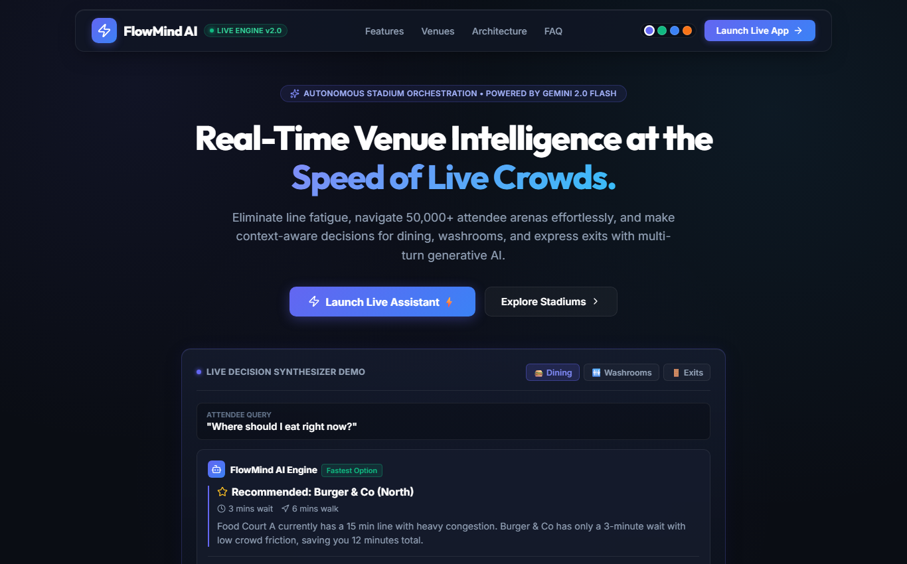
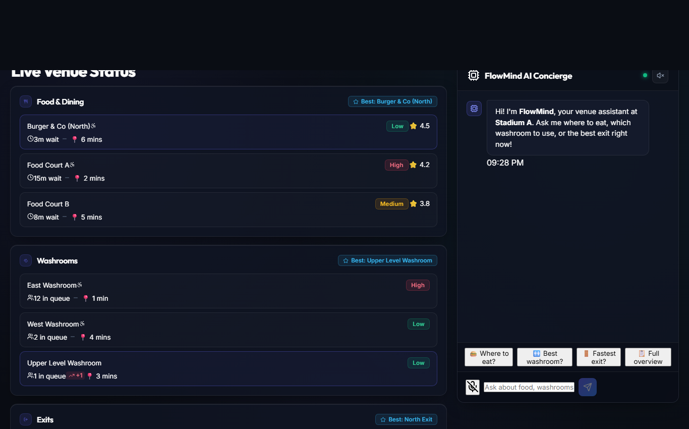

# ⚡ FlowMind AI — Real-Time Venue Decision Intelligence Assistant

[](https://akashnarayanan007.github.io/flowmind-ai/)
[](https://github.com/akashnarayanan007/flowmind-ai/actions)
[](https://vitest.dev)
[](https://react.dev)
[](https://vitejs.dev)
[](https://aistudio.google.com)
[](LICENSE)

> 🌐 **Live Demo URL:** **[https://akashnarayanan007.github.io/flowmind-ai/](https://akashnarayanan007.github.io/flowmind-ai/)**  
> **FlowMind AI** is an autonomous, context-aware decision intelligence platform designed for massive 50,000+ attendee arenas. By combining real-time simulated IoT sensor telemetry with **Google Gemini 2.0 Flash** and dynamic vector wayfinding, FlowMind steers attendees away from bottlenecks to the shortest queues, nearest food concessions, and express exits in real time.

---

## 📸 Product Showcase

### 1. Showcase Landing Page & Interactive Decision Synthesizer
*Features high-impact telemetry metrics, interactive query simulation teaser, and 1-click multi-venue switcher.*



---

### 2. Live Decision Assistant & Dynamic Vector Map
*Real-time facility status grid, animated shortest-route SVG floorplan, and multi-turn Gemini 2.0 Flash AI concierge with voice recognition.*



---

## 🌟 Key Highlights & Innovations

* **🤖 Multi-Turn Gemini 2.0 Flash:** Integrates `@google/generative-ai` with conversation history (`startChat({ history })`). Formulates quantitative comparisons across facilities, prioritizes lowest composite friction `(Wait Time + Crowd Penalty × 3)`, and outputs bold Markdown recommendations.
* **⚡ Dual-Cadence IoT Sensor Simulation:** An Observer pattern data layer mirrors Firebase Realtime DB. Executes a fast loop (every 3s) for concessions and gate throughput, and a slow loop (every 60s) for restroom queue drainage with crowd spike probabilities.
* **🗺️ Dynamic Vector Floorplan (SVG):** Calculates direct wayfinding vectors from attendee position to the single best facility, complete with animated directional dashes and real-time walk ETA.
* **🚨 Threshold-Triggered Congestion Alerts:** Proactive toast notifications automatically fire whenever a venue node experiences a crowd surge exceeding 50%.
* **🎙️ Multimodal Voice & Audio:** Hands-free speech recognition (Web Speech API) and Text-to-Speech (TTS) audio playback.
* **🎨 4-Palette Theme Engine:** Clean Linear/Vercel-inspired dark theme by default, with instant 1-click theme switching between **Electric Indigo**, **Emerald Mint**, **Royal Cobalt**, and **Warm Sunset**.
* **🛡️ Zero-Trust Security & Fallback:** Strict regex input sanitization against injection, client-side rate-limiting (10 req/min), and an offline deterministic mock fallback engine if Wi-Fi drops.
* **♿ WCAG 2.1 AA Accessibility:** Full ARIA landmark structure, `aria-live` regions for alerts, skip navigation links, high-contrast typography, and accessible route flags.

---

## 🏛️ Architecture & Data Pipeline

```text
 ┌──────────────────────────────────────────────────────────────────┐
 │                     FlowMind AI Architecture                     │
 └──────────────────────────────────────────────────────────────────┘

       IoT SENSORS & CONCESSIONS SIMULATION (Observer Pattern)
     ┌────────────────────────┐      ┌────────────────────────┐
     │ 3s Concession & Gates  │      │  60s Washroom Queues   │
     └───────────┬────────────┘      └───────────┬────────────┘
                 │                               │
                 └───────────────┬───────────────┘
                                 ▼
                     Live Data Event Hub
                  (dataService.js Observers)
                                 │
           ┌─────────────────────┴─────────────────────┐
           ▼                                           ▼
   Real-Time Venue State                    Congestion Spike Monitor
   (Food / Restrooms / Gates)               (AlertBanner Toast Engine)
           │
           ▼
 ┌──────────────────────────────────────────────────────────────────┐
 │             Autonomous Decision Engine (aiService.js)            │
 │                                                                  │
 │  Attendee Coordinates + Active Category + Live Facility Status   │
 │                                 │                                │
 │       ┌─────────────────────────┴─────────────────────────┐      │
 │       ▼                                                   ▼      │
 │  Google Gemini 2.0 Flash API                 Local Deterministic │
 │  (Multi-turn Memory + Reasoning)             Friction Engine     │
 └─────────────────────────────────┬────────────────────────────────┘
                                   │
                                   ▼
 ┌──────────────────────────────────────────────────────────────────┐
 │                      Multimodal Output Layer                     │
 │  • Dynamic Vector SVG Map (Shortest Route & ETA)                 │
 │  • Markdown AI Decision Bubble with bold recommendation          │
 │  • Web Speech Audio Synthesis (Text-to-Speech)                   │
 └──────────────────────────────────────────────────────────────────┘
```

---

## 🏟️ Simulated Venues Overview

FlowMind AI includes 4 diverse stadium topologies:

| Stadium | Tag | Capacity | Layout Profile |
|:---|:---|:---:|:---|
| **Stadium A** | `Balanced` | 42,000 | Main arena with evenly distributed dining courts, central washrooms, and express gates. |
| **Stadium B** | `Dense Amenities` | 35,000 | East wing venue optimized for high food court density and fast concession turnover. |
| **Stadium C** | `Exit-Heavy` | 28,000 | West concourse engineered with 4 major egress gates for rapid mass transit evacuation. |
| **Stadium D** | `VIP Premium` | 15,000 | Premium tier stadium with fine dining, private lounge restrooms, and concierge gates. |

---

## 🚀 Quick Start Guide

### Prerequisites
* **Node.js**: `v18.0.0` or higher (Node 20+ recommended)
* **npm**: `v9.0.0` or higher

### Installation

```bash
# 1. Clone the repository
git clone https://github.com/akashnarayanan007/flowmind-ai.git

# 2. Enter project folder
cd flowmind-ai

# 3. Install dependencies
npm install
```

### Running Locally

```bash
# Start development server
npm run dev
```
Open [http://localhost:5173](http://localhost:5173) in your browser.

---

## 🔑 Gemini AI Configuration (Optional)

FlowMind AI operates completely offline out of the box using its built-in **deterministic decision synthesizer**.

To enable live **Google Gemini 2.0 Flash**:

1. Get a free API key at [Google AI Studio](https://aistudio.google.com/app/apikey).
2. Create a `.env` file in the project root:
   ```env
   VITE_GEMINI_API_KEY=your_gemini_api_key_here
   ```
3. Restart your dev server (`npm run dev`).

---

## 🧪 Testing, Quality & Linting

The repository is verified with a comprehensive suite of **69 automated unit, integration, and security tests**:

```bash
# Run unit & security test suite (Vitest)
npm test

# Run tests in interactive watch mode
npm run test:watch

# Validate linting (0 errors, 0 warnings)
npm run lint

# Build production bundle
npm run build

# Preview production build locally
npm run preview

# Regenerate showcase screenshots with Headless Chrome
npm run screenshots
```

---

## 🐳 Docker Deployment

A production-ready, multi-stage `Dockerfile` is included for standalone containers or Google Cloud Run deployments:

```bash
# Build the Docker image
docker build -t flowmind-ai .

# Run the container on port 8080
docker run -p 8080:8080 flowmind-ai
```
Visit [http://localhost:8080](http://localhost:8080).

---

## 🛡️ Security & Privacy Guardrails

* **Input Sanitization:** Strips HTML script tags, quotes, backticks, and enforces a hard 500-character cap via `sanitizeInput()`.
* **Client Rate Limiting:** Enforces a maximum threshold of 10 AI queries per minute per attendee session.
* **Responsible AI Filters:** Gemini API safety settings configured at `BLOCK_MEDIUM_AND_ABOVE` across harassment, hate speech, and explicit content.
* **Zero System State Leakage:** Internal stack traces and backend sensor endpoints are completely abstracted from user-facing surfaces.

---

## ♿ Accessibility Compliance (WCAG 2.1 AA)

* **Semantic Landmarks:** Full structure across `<main>`, `<header>`, `<footer>`, `<nav>`, and `<aside>`.
* **Dynamic ARIA Regions:** Live updates routed to `aria-live="polite"` for chat responses and `aria-live="assertive"` for critical congestion alerts.
* **Keyboard Navigation:** Includes a skip link (`#main-content`) and distinct `:focus-visible` rings on all interactive elements.
* **Inclusive Wayfinding:** Concessions and restrooms explicitly flag wheelchair-accessible pathways (`accessible: true`).

---

## 📄 License

Distributed under the [MIT License](LICENSE) &copy; 2026 FlowMind AI Contributors.
